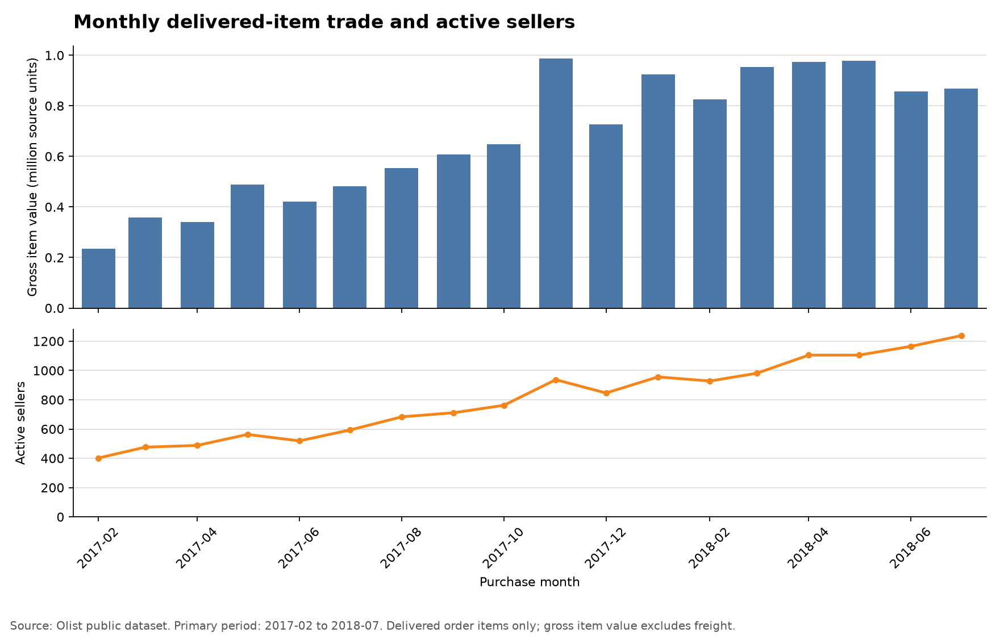
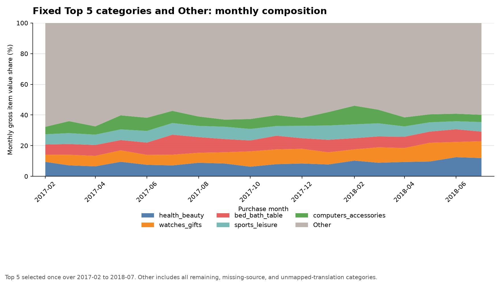
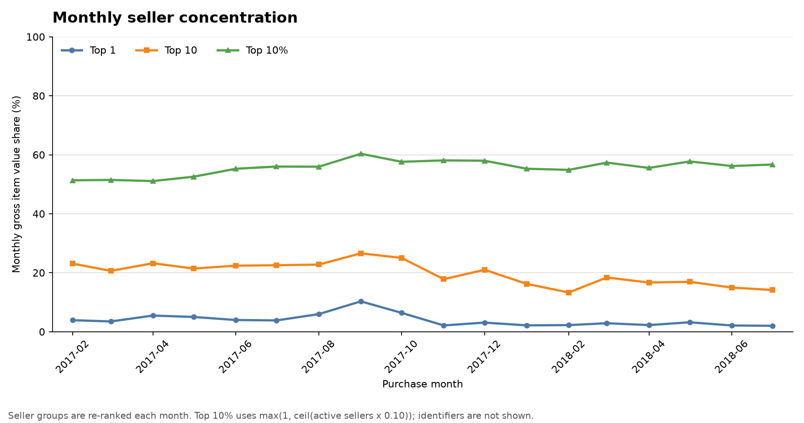

# 카테고리·판매자 거래 분석 결과

## 분석 질문과 대상

배송 완료 주문상품에서 관찰된 상품 거래액이 어떤 카테고리와 익명 판매자군에
집중됐으며, 그 구성과 집중도가 구매월별로 어떻게 달라졌는지 확인했다.

입력은 검증된 `analytics.mart_category_trade_monthly`과 `analytics.mart_seller_trade_monthly`이다. 두 mart는 서로
join하지 않고 같은 read-only snapshot에서 각각 읽은 뒤 월별 가산 지표를 대사했다.
주 분석 기간은 원천 coverage 경계를 제외한 **2017년 2월~2018년 7월 18개월**이다.
2016년 9월~2017년 1월과 2018년 8월은 참고 구간이며 아래 결과 계산에는 포함하지
않았다.

## 한 줄 결과

고정 Top 5 카테고리는 주 분석 기간 상품 거래액의 39.9%를 차지했다.
Top 5의 월별 합산 비중은 32.3%~46.0%였고,
판매자 Top 10 비중은 첫 달 23.1%에서 마지막 달
14.1%로 달라졌다. 전체 변화를 단일 카테고리나 판매자
한 곳의 결과로 단정하기보다 월별 구성과 집중도를 함께 점검해야 한다.

## 1. 월별 상품 거래액과 활동 판매자 수



- 주 분석 기간 상품 거래액: 12,230,652.13
- 별도 배송비: 2,029,493.87
- 배송 완료 주문상품 행: 101,825개
- 월별 활동 판매자 수 범위: 402~1,238명
- 첫 달 → 마지막 달 상품 거래액: 234,223.40 →
  867,953.46
- 첫 달 → 마지막 달 활동 판매자 수: 402명 →
  1,238명

상품 거래액은 `order_items.price`의 합이며 회사 매출·순매출·이익이 아니다. 배송비는
상품 거래액에 섞지 않고 별도 지표로 유지했다. 금액은 원천 데이터와 같은 금액 단위를
사용했다.

## 2. 고정 Top 5 카테고리와 Other 구성



Top 5는 주 분석 기간 전체 상품 거래액으로 한 번 선정하고 같은 카테고리를 매월
추적했다. 나머지 카테고리와 원천 category 누락·번역 미연결은 모두 `Other`다.

- health_beauty: 1,097,800.05 (8.98%)
- watches_gifts: 1,085,612.33 (8.88%)
- bed_bath_table: 958,260.32 (7.83%)
- sports_leisure: 892,768.08 (7.30%)
- computers_accessories: 844,078.81 (6.90%)

월간 상품 거래액의 절대 변화가 가장 컸던 달은 2017년 11월로, 직전 달보다
339,517.72 증가했다. 같은 산술 분해에서 절대 변화가
가장 큰 고정 그룹은 `Other`이며 187,790.47
증가했다. 이는 변화의 원인을 증명하는 기여도가 아니라 후속 점검 순서를
정하기 위한 기술통계다.

Top 5 합산 비중은 첫 달 32.3%, 마지막 달 40.1%였다.
최저는 2017년 02월 32.3%,
최고는 2018년 02월 46.0%였다.
고정된 다섯 category를 추적한 구성 변화이며 원인이나 개별 성과를 뜻하지 않는다.

## 3. 익명 판매자군 거래액 집중도



- 월별 Top 1 비중 범위: 2.0%~10.3%
- 월별 Top 10 비중: 최저 2018년 02월
  13.3%, 최고 2017년 09월
  26.6%
- 월별 상위 10% 비중: 최저 2017년 04월
  51.1%, 최고
  2017년 09월
  60.3%
- 첫 달 → 마지막 달 상위 10% 비중: 51.3% →
  56.7%

Top 1·Top 10·상위 10%는 매월 다시 선정했으므로 동일 판매자군의 성장이나 감소를
뜻하지 않는다. 공개 결과에는 판매자 식별자와 상세 위치를 포함하지 않았다.

## category mapping 잔존 상태

주 분석 기간 category mart의 전체 합계를 보존한 상태에서 확인했다.

| 상태 | 상품 거래액 비중 | 주문상품 행 비중 |
|---|---:|---:|
| mapped (번역 연결) | 98.609% | 98.518% |
| missing_source (원천 category 누락) | 1.364% | 1.465% |
| unmapped_translation (번역 미연결) | 0.026% | 0.017% |

누락·미연결 상태를 정상 category로 바꾸거나 분석에서 조용히 제거하지 않았다.

## 계산·검증 기준

- 모집단: `order_status = 'delivered'`인 주문상품
- 월 기준: 주문 구매월
- 고정 Top 5: 승인 기간의 mapped category 상품 거래액 내림차순, 동률은 내부
  `category_key` 오름차순
- 판매자 집중도: 월별 상품 거래액 내림차순, 동률은 내부 `seller_id` 오름차순
- 상위 10% 판매자 수: `max(1, ceil(활동 판매자 수 × 0.10))`
- category·seller mart의 월별 상품 거래액·배송비·상품 측 합계·주문상품 행 수를
  exact 대사
- SQL 기준 Top 5·category 구성·판매자 집중도·mapping 상태 집계와 pandas 결과 대사
- 비중 합은 반올림 전에 `abs(합계 - 1) <= 1e-12`로 검사

## 해석과 활용

고정 Top 5 구성과 판매자 집중도를 함께 보면 월별 상품 거래액 변화가 넓은 그룹에
분산됐는지 일부 그룹과 함께 나타났는지 우선 점검할 수 있다. 후속 분석에서는 큰
월간 변화가 관찰된 카테고리의 주문상품 수·판매자 수·상품 거래액 변화를 분리해
확인하는 것이 우선이다.

## 한계

- 2016~2018년 고정 Olist 공개 snapshot의 기술통계이며 현재 시장을 대표하지 않는다.
- 배송 완료 주문상품만 포함하므로 취소·미완료 주문의 거래 특성을 설명하지 않는다.
- 상품 거래액 변화만으로 수요·재고·프로모션·판매자 성과의 원인을 단정할 수 없다.
- 방문·광고비·원가·환불 자료가 없어 전환·ROAS·이익을 계산하지 않는다.
- 집중도는 점검 신호이며 실제 사업 위험이나 개선 성과를 증명하지 않는다.

## 재현 방법

로컬 PostgreSQL에 검증된 mart가 구축되고 `.env`가 준비된 상태에서 실행한다.

```bash
.venv/bin/python scripts/analyze_category_seller_trade.py build
.venv/bin/python scripts/analyze_category_seller_trade.py check
```

`build`는 SQL↔pandas 대사와 고정 snapshot 검사가 통과한 뒤 보고서와 차트 3개를
생성한다. `check`는 같은 입력과 고정 의존성 환경에서 산출물을 다시 만들어 커밋된
파일과 같은지 확인하며 기존 파일을 수정하지 않는다.
