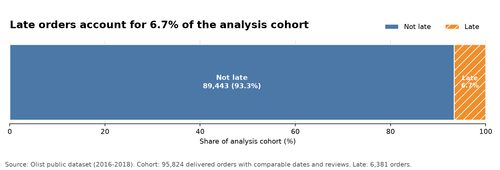
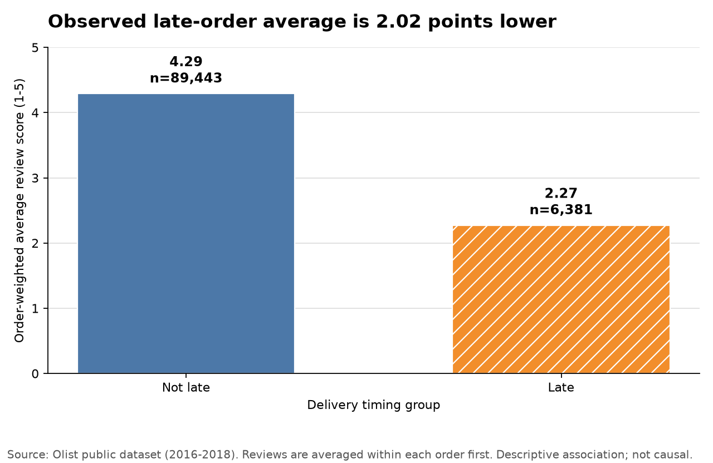

# 배송 지연·리뷰 분석 결과

## 분석 질문과 대상

약속한 달력 날짜를 넘긴 주문과 넘기지 않은 주문의 주문별 평균 리뷰 점수(1–5점)를
비교했다.
입력은 검증된 `analytics.mart_delivery_review_orders` 한 개이며, 한 행은 배송 완료·날짜
비교 가능·리뷰 보유 주문 1건이다. 최종 분석 대상은 95,824건이다.

비교 불가능한 배송일과 리뷰가 없는 주문은 입력 mart에서 이미 제외돼 있다. 전체 포함·
제외 건수와 upstream 검산은 [배송 지연·리뷰 mart 검증](delivery-review-mart-validation.md)에
기록돼 있다.

## 한 줄 결과

최종 분석 대상에서 지연 주문은 6,381건
(6.66%)이었다. 지연 주문의 주문 동일가중 평균 리뷰 점수는
2.27점, 비지연 주문은
4.29점으로, 지연 그룹이
2.02점 낮게 관찰됐다.

이 차이는 관찰된 관계이며 배송 지연의 인과 효과가 아니다.

## 1. 분석 대상 내부의 배송 지연 비율



- 비지연: 89,443건
  (93.34%)
- 지연: 6,381건 (6.66%)
- 비지연은 예정일보다 일찍 도착한 주문과 예정일 당일 도착한 주문을 합친 값이다.

## 2. 배송 지연 여부별 평균 리뷰 점수



- 비지연 주문 평균: 4.29점
- 지연 주문 평균: 2.27점
- 지연 - 비지연 관찰 차이: -2.02점

한 주문에 리뷰가 여러 개 있으면 주문 안에서 먼저 평균을 냈다. 그다음 주문별 평균을
다시 평균해 각 주문에 같은 가중치를 부여했다. 최종 95,824건에는 리뷰
원천 96,353행이 연결돼 있으며, 복수 리뷰 주문
525건도 주문 1건으로 동일하게 가중됐다.

## 해석

이번 결과는 배송 약속 준수 여부와 리뷰 지표를 함께 모니터링하고, 지연 그룹의 낮은
평가가 어떤 판매자·카테고리·지역에서 반복되는지 후속 진단할 근거가 될 수 있다.
그러나 현재 비교만으로 배송 지연이 점수 차이를 만들었다거나 배송 개선 시 점수가
2.02점 상승한다고 말할 수는 없다.

## 계산·검증 기준

- 지연: `delivery_days_vs_estimate > 0`
- 비지연: `early + promised_date`
- 지연률 분모: 최종 배송 완료·날짜 비교 가능·리뷰 보유 주문
- 리뷰 평균: 주문 안의 리뷰를 먼저 평균한 뒤 주문을 동일 가중
- SQL 기준 집계와 pandas의 주문 수, 리뷰 행 수, 점수 합과 그룹별 평균을 같은
  read-only snapshot에서 대사
- 고정 Olist snapshot 회귀 수치도 함께 검사

## 실행 결과

- pandas `build`와 `check`: 성공
- 전체 dbt build: 20개 모델과 245개 data test, 총 265개 노드 통과
- PostgreSQL 연동을 포함한 Python unittest: 34개 통과

## 한계

- 리뷰가 있고 배송일을 비교할 수 있는 완료 주문만 포함하므로 선택 편향이 있을 수 있다.
- 배송 지연은 timestamp 시각이 아니라 달력 날짜 기준이다.
- 판매자·카테고리·지역·계절 같은 교란 요인을 통제하지 않았다.
- chronology flag가 있는 주문도 임의로 제거하지 않았다.
- 통계적 유의성이나 인과 효과를 검정하지 않았다.
- 2016–2018년 고정 Olist 공개 데이터의 결과로 현재 시장 전체를 대표하지 않는다.

## 재현 방법

로컬 PostgreSQL에 검증된 mart가 구축되고 `.env`가 준비된 상태에서 실행한다.

```bash
.venv/bin/python scripts/analyze_delivery_reviews.py build
.venv/bin/python scripts/analyze_delivery_reviews.py check
```

`build`는 SQL↔pandas 대사가 통과한 뒤 이 보고서와 차트 2개를 생성한다. `check`는 같은
고정 의존성 환경과 입력에서 다시 만든 산출물이 커밋된 파일과 같은지 확인하며 기존
파일을 수정하지 않는다.
