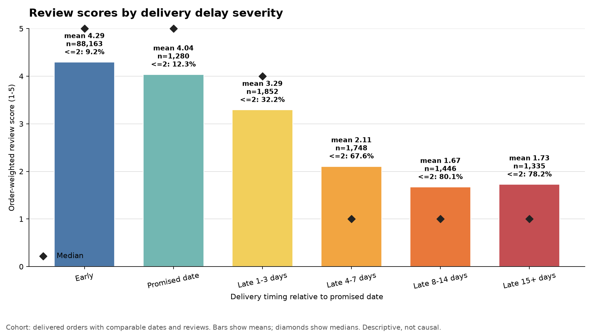
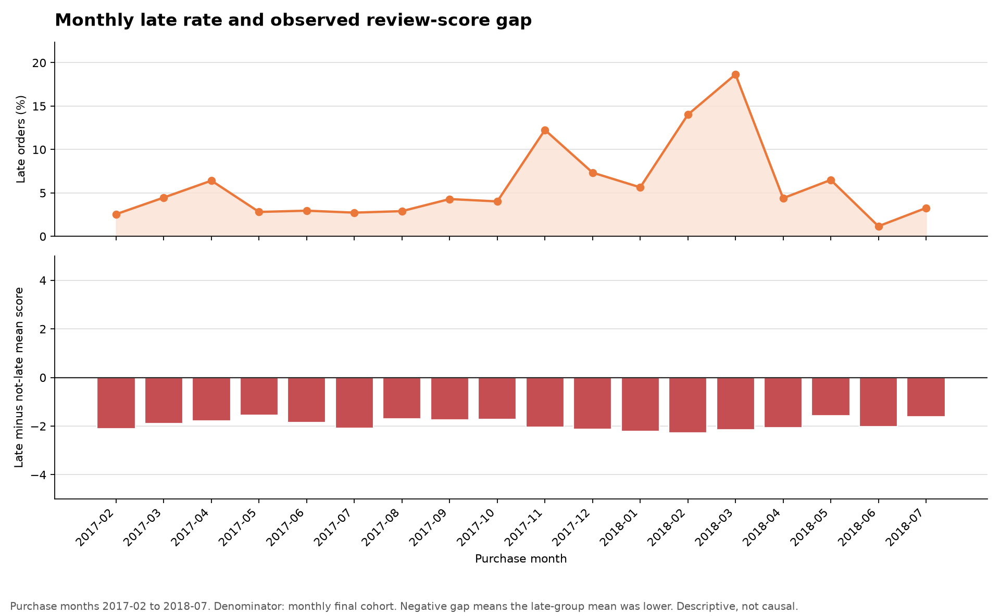

# 배송 지연 강도·시점 안정성 분석 결과

## 분석 질문과 대상

배송 지연 강도에 따라 주문 동일가중 평균 리뷰가 어떻게 달라지는지, 기존
late-vs-not-late 차이가 비교 가능한 구매월 구간에서도 같은 방향으로 관찰되는지
확인했다.

입력은 검증된 `analytics.mart_delivery_review_orders` 한 개이며 한 행은 배송 완료·날짜 비교 가능·리뷰 보유
주문 1건이다. 전체 final cohort는 95,824건이다. 지연 강도는 예정일 대비
달력 날짜 차이로 정의하며 총 배송 소요일을 뜻하지 않는다.

## 한 줄 결과

15일 이상 지연 그룹 1,335건의 주문 동일가중 평균 리뷰는 1.73점이었고, 전체 not-late 평균 4.29점보다 2.56점 낮게 관찰됐다. 평균 차이를 계산할 수 있는 승인 비교 기간 18개월 중
18개월에서 late 평균이 not-late 평균보다 낮았다. 이는 기술통계이며 배송
지연의 인과 효과가 아니다.

## 1. 배송 지연 강도별 리뷰



| 배송 상태·지연 강도 | 주문 수 | 전체 비중 | 평균 리뷰 | 중앙값 | 주문 평균 2점 이하 비율 |
|---|---:|---:|---:|---:|---:|
| 전체 final cohort | 95,824 | 100.00% | 4.16 | 5.00 | 12.77% |
| Early | 88,163 | 92.01% | 4.29 | 5.00 | 9.19% |
| Promised date | 1,280 | 1.34% | 4.04 | 5.00 | 12.27% |
| Late 1-3 days | 1,852 | 1.93% | 3.29 | 4.00 | 32.18% |
| Late 4-7 days | 1,748 | 1.82% | 2.11 | 1.00 | 67.56% |
| Late 8-14 days | 1,446 | 1.51% | 1.67 | 1.00 | 80.08% |
| Late 15+ days | 1,335 | 1.39% | 1.73 | 1.00 | 78.20% |

- `early`는 예정일 전 배송, `promised_date`는 예정일 당일 배송이다.
- late 구간은 1–3일, 4–7일, 8–14일, 15일 이상으로 사전에 고정했다.
- 평균과 중앙값은 원천 리뷰 행이 아니라 주문 안에서 먼저 평균된 값을 주문별로 동일
  가중한 결과다.
- 평균 2점 이하 비율의 분모는 각 구간 주문 수다.
- 8–14일 지연 평균은 1.67점, 15일 이상은 1.73점이었다. 8–14일 평균이 조금 더 낮아 지연 구간 전체가 일수와 함께 엄격하게 단조 악화한 형태는 아니었다.

## 2. 구매월별 late-vs-not-late 안정성



주 분석 기간은 원천 coverage 경계를 제외한 2017-02부터 2018-07 구매월이다. 월별
지연률 분모는 해당 월 final cohort이며, 점수 차이는 `late 평균 - not-late 평균`이다.

| 구매월 | 전체 주문 | late 주문 | late 비율 | not-late 평균 | late 평균 | 평균 차이 |
|---|---:|---:|---:|---:|---:|---:|
| 2017-02 | 1,643 | 42 | 2.56% | 4.26 | 2.14 | -2.11 |
| 2017-03 | 2,527 | 113 | 4.47% | 4.27 | 2.39 | -1.88 |
| 2017-04 | 2,290 | 147 | 6.42% | 4.25 | 2.47 | -1.79 |
| 2017-05 | 3,517 | 99 | 2.81% | 4.28 | 2.74 | -1.54 |
| 2017-06 | 3,111 | 92 | 2.96% | 4.28 | 2.43 | -1.84 |
| 2017-07 | 3,842 | 105 | 2.73% | 4.32 | 2.24 | -2.08 |
| 2017-08 | 4,165 | 121 | 2.91% | 4.36 | 2.65 | -1.71 |
| 2017-09 | 4,118 | 177 | 4.30% | 4.34 | 2.59 | -1.75 |
| 2017-10 | 4,446 | 179 | 4.03% | 4.27 | 2.55 | -1.73 |
| 2017-11 | 7,237 | 887 | 12.26% | 4.24 | 2.20 | -2.04 |
| 2017-12 | 5,461 | 401 | 7.34% | 4.25 | 2.11 | -2.13 |
| 2018-01 | 7,013 | 396 | 5.65% | 4.23 | 2.01 | -2.22 |
| 2018-02 | 6,507 | 912 | 14.02% | 4.20 | 1.92 | -2.28 |
| 2018-03 | 6,948 | 1,296 | 18.65% | 4.21 | 2.07 | -2.14 |
| 2018-04 | 6,752 | 297 | 4.40% | 4.30 | 2.23 | -2.06 |
| 2018-05 | 6,722 | 437 | 6.50% | 4.34 | 2.76 | -1.58 |
| 2018-06 | 6,072 | 71 | 1.17% | 4.33 | 2.31 | -2.02 |
| 2018-07 | 6,118 | 200 | 3.27% | 4.37 | 2.75 | -1.62 |

월별 결과가 같은 방향이라고 해서 계절, 판매자·상품 구성이나 지역 차이가 통제됐다는
뜻은 아니다. 월별 표본 수와 final cohort의 선택 조건을 함께 봐야 한다.

## 3. Chronology sensitivity

원천 timestamp의 논리적 순서 역전 flag가 하나라도 true인
1,366건을 제외한 뒤 같은 headline 지표를 다시
계산했다. 승인·출고 timestamp가 없다는 missing flag만으로는 제외하지 않았다.

| cohort | 주문 수 | late 주문 | late 비율 | not-late 평균 | late 평균 | 평균 차이 |
|---|---:|---:|---:|---:|---:|---:|
| 전체 final cohort | 95,824 | 6,381 | 6.66% | 4.2906 | 2.2718 | -2.0188 |
| chronology 역전 제외 | 94,458 | 6,357 | 6.73% | 4.2900 | 2.2705 | -2.0196 |

전체 평균 차이는 -2.0188점, 역전 제외 후 -2.0196점으로 -0.0008점 변했다. 이 비교는 결과의 민감도를 확인하는 절차다.
역전 flag가 있는 행을 업무 오류라고 판정하거나 기본 cohort에서 삭제하는 정책 변경이
아니다.

## 계산·검증 기준

- 전체 95,824건, 리뷰 원천 96,353행, 리뷰 점수 합
  400,413, 주문별 평균 점수 합을 severity 그룹과 SQL baseline에 exact 대사
- severity 각 구간과 월별 집계의 주문 수·리뷰 행 수·점수 합·주문별 평균 점수 합을
  SQL과 exact 대사
- 비율과 평균은 exact 분자·분모에서 각각 다시 계산하고, 중앙값 등 파생 실수의 표현
  일치에만 절대 오차 `1e-12` 적용
- 지연 일수 anchor `p25=3`, `median=7`, `p75=13`, `max=188` 재현 확인
- 같은 `repeatable read`, `read only` transaction에서 mart와 독립 SQL baseline을 조회
- 보고서와 차트에는 주문 ID, 리뷰 원문이나 행 단위 데이터를 포함하지 않음

## 해석과 한계

- 리뷰가 있고 배송일을 비교할 수 있는 delivered 주문만 포함하므로 선택 편향이 있을 수
  있다. 기존 검증에서 late 그룹의 리뷰 coverage가 상대적으로 낮았다.
- 지연 일수는 총 배송 기간이 아니라 실제 배송일과 예정일의 달력 날짜 차이다.
- 구간 경계와 평균 2점 이하 기준은 설명을 위한 분석 정책이며 업무상 절대 기준이 아니다.
- 판매자·카테고리·상품·지역과 계절 같은 교란요인을 통제하지 않았다.
- 심한 지연 구간의 표본 수가 작으면 평균과 비율이 불안정할 수 있어 주문 수를 함께
  표시했다.
- 통계적 유의성, 예측 성능이나 인과 효과를 검정하지 않았다.
- chronology 제외 결과는 민감도 확인이며 해당 행을 오류로 판정한 결과가 아니다.
- 2016–2018년 고정 Olist 공개 데이터의 기술통계로 현재 시장 전체를 대표하지 않는다.

## 재현 방법

로컬 PostgreSQL에 검증된 mart가 구축되고 `.env`가 준비된 상태에서 실행한다.

```bash
.venv/bin/python scripts/analyze_delivery_review_deepening.py build
.venv/bin/python scripts/analyze_delivery_review_deepening.py check
```

`build`는 SQL↔pandas 대사가 통과한 뒤 이 보고서와 차트 2개를 임시 위치에 모두 만든 후
교체한다. `check`는 같은 입력과 고정 의존성 환경에서 다시 만든 산출물이 기존 파일과
같은지 확인하며 기존 파일을 수정하지 않는다.
